# Блок 4. CDC + Kafka + Debezium — отчёт

Окружение: PostgreSQL 16 (`wal_level=logical`), Kafka (KRaft, 1 нода), Kafka Connect 2.6 (Debezium
2.6.2.Final), Kafka UI v0.7.2. Все скриншоты — в `screenshots/`.

---

# Блок 1. CDC

## Задание 1. Подготовка WAL

`SHOW wal_level` возвращает `logical`. В `docker-compose.yml` это задано параметром запуска
`-c wal_level=logical` в сервисе `postgres`, поэтому править compose и перезапускать контейнер
не понадобилось:

```yaml
command: >
  postgres
  -c wal_level=logical
  -c max_wal_senders=10
  -c max_replication_slots=10
  -c max_slot_wal_keep_size=1GB
```

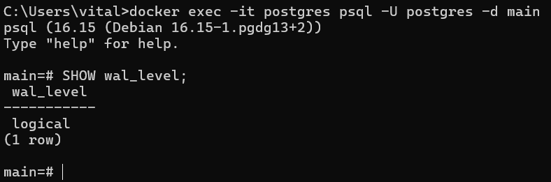

Текущий WAL-файл и его чтение через `pg_waldump`:

```
pg_current_wal_lsn = 0/1A196F8
pg_walfile_name    = 000000010000000000000001
```

Вывод `pg_waldump` — записи `rmgr: Heap` и `rmgr: Btree`, подтверждающие, что в журнал
пишутся изменения и таблиц, и индексов:

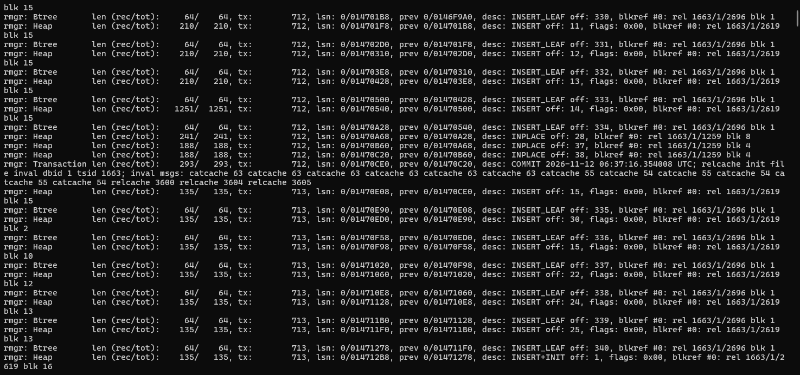

## Задание 2. Слот и публикация

### test_decoding: peek и get

Слот `slot_td` с плагином `test_decoding` создан, изменения сгенерированы
`simulate_telemetry(15)`. `peek_changes` дал **15** строк, повторный `peek_changes` — снова
**15**: слот не сдвигается. `get_changes` вернул те же **15** строк, после чего слот сдвинулся.

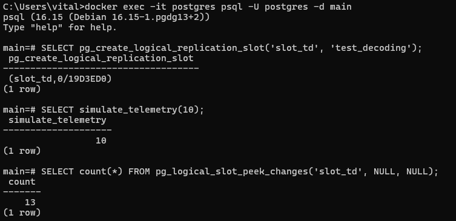

Подсчёт операций по выводу `test_decoding`:

| op | cnt |
|---|---|
| DELETE | 3 |
| INSERT | 4 |
| UPDATE | 8 |

Сумма = 15, что совпадает с числом изменённых строк, сгенерированных `simulate_telemetry(15)`.

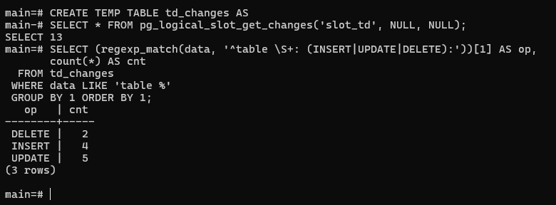

Слот удалён:

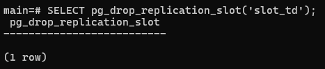

### pgoutput + publication

Создан слот `slot_pgo` с плагином `pgoutput` и публикация `pub_blk1` на две таблицы. Обе таблицы
видны в `pg_publication_tables`. Изменения прочитаны через `pg_logical_slot_peek_binary_changes`
с параметрами `proto_version=1`, `publication_names=pub_blk1`.

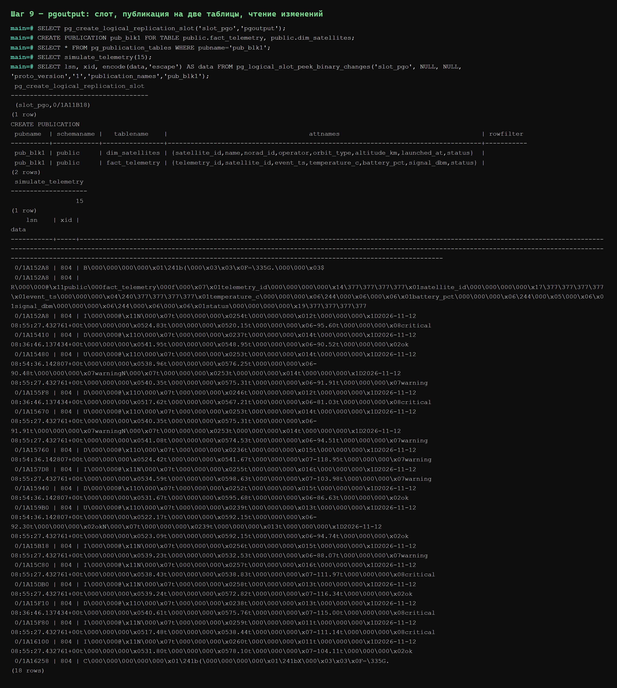

Вывод `pgoutput` бинарный, что ожидаемо: `pgoutput` отдаёт поток репликации в двоичном формате
PostgreSQL, а не текст. Читаемое текстовое представление даёт `test_decoding`; расшифровка
`pgoutput` выполняется на стороне подписчика (Debezium) — что и происходит в Блоке 2.

## Задание 3. before / after

Сравнение поведения `REPLICA IDENTITY DEFAULT` и `FULL` на таблице `fact_telemetry`.

### UPDATE

| REPLICA IDENTITY | `relreplident` | что приходит |
|---|---|---|
| DEFAULT | `d` | только `new-tuple` |
| FULL | `f` | `old-key` + `new-tuple` |

При `DEFAULT` старое состояние не передаётся — в выводе есть только новое:

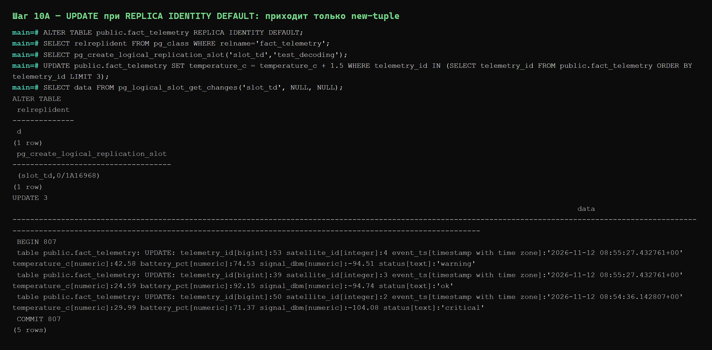

При `FULL` приходят оба состояния. Что изменилось и на сколько — `temperature_c`:

| telemetry_id | old `temperature_c` | new `temperature_c` | Δ |
|---|---|---|---|
| 36 | 22.84 | 24.34 | +1.50 |
| 37 | 40.45 | 41.95 | +1.50 |
| 38 | 39.11 | 40.61 | +1.50 |

Остальные колонки (`battery_pct`, `signal_dbm`, `status`, `satellite_id`, `event_ts`) в
`old-key` и `new-tuple` совпадают. Дельта +1.50 на всех трёх строках — ровно та, что задана в
`UPDATE ... temperature_c = temperature_c + 1.5`.

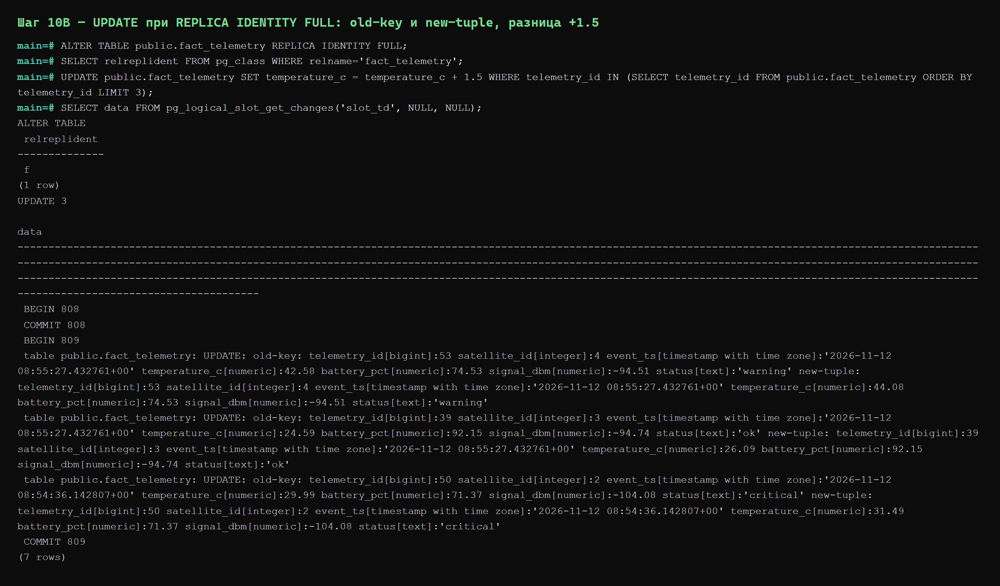

### DELETE

| REPLICA IDENTITY | что попадает в старое состояние |
|---|---|
| FULL | вся строка целиком (все колонки) |
| DEFAULT | только первичный ключ (`telemetry_id`) |

При `FULL` в старом состоянии перечислены все колонки:

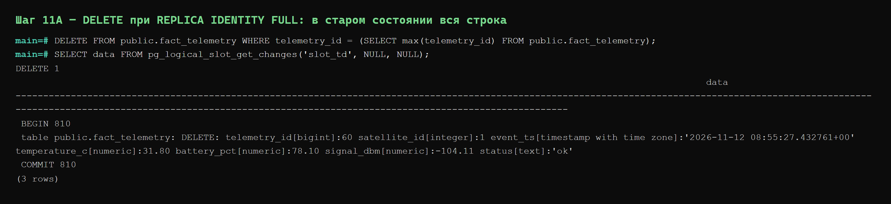

При `DEFAULT` — только `telemetry_id[bigint]`, остальных значений нет:

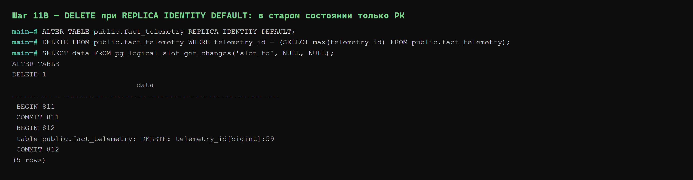

**Вывод:** `REPLICA IDENTITY DEFAULT` передаёт в старое состояние только ключевые колонки, поэтому
`before` в CDC-событии неполный. Для получения полного `before` (что и требуется в Блоке 2)
необходим `REPLICA IDENTITY FULL` — он выставлен на обеих таблицах.

---

# Блок 2. Kafka + Debezium

## Задание 1. Подготовка окружения

Поднят Docker Compose из четырёх сервисов: `postgres`, `kafka` (KRaft, одна нода),
`kafka-connect` (Debezium), `kafka-ui`. В Kafka UI кластер `nrt-cluster` в статусе `online`,
Kafka Connect `connect` виден.

Перед запуском коннектора удалены неактуальные слоты и публикации Блока 1 (`slot_td`, `slot_pgo`,
`pub_blk1`), чтобы Debezium создал собственные.

## Задание 2. Настройка Debezium

Коннектор `telemetry-connector` создан через Kafka UI. Итоговый конфиг — в `connector.json`.

Ключевые настройки:

| Параметр | Значение | Зачем |
|---|---|---|
| `topic.prefix` | `nrt` | имя топика = `<prefix>.<schema>.<table>` |
| `plugin.name` | `pgoutput` | логическое декодирование |
| `slot.name` | `debezium_slot` | слот создаётся автоматически |
| `publication.name` | `dbz_pub` | публикация создаётся автоматически |
| `publication.autocreate.mode` | `filtered` | в публикацию попадают только таблицы из `table.include.list` |
| `table.include.list` | `public.fact_telemetry,public.dim_satellites` | отслеживаемые таблицы |
| `snapshot.mode` | `no_data` | исторические строки не выливаются в Kafka |
| `decimal.handling.mode` | `double` | числа приходят числами, а не Base64 |
| `tombstones.on.delete` | `false` | без пустых tombstone-сообщений |

Схема в сообщения не пишется (`schemas.enable=false` в конвертерах Connect и в конфиге
коннектора), поэтому событие компактное — только полезная нагрузка.

## Задание 3. Проверка потока

Слот создан Debezium автоматически и **активен**, публикация создана автоматически и содержит
обе таблицы:

```sql
SELECT slot_name, plugin, database, active, confirmed_flush_lsn
  FROM pg_replication_slots
 WHERE slot_name = 'debezium_slot';

SELECT * FROM pg_publication_tables WHERE pubname = 'dbz_pub';
```

```
   slot_name   |  plugin  | active
---------------+----------+--------
 debezium_slot | pgoutput | t

 pubname | schemaname |    tablename
---------+------------+------------------
 dbz_pub | public     | dim_satellites
 dbz_pub | public     | fact_telemetry
```

Выполнены `INSERT` и `UPDATE` в `fact_telemetry`, оба события найдены в топике
`nrt.public.fact_telemetry`. `INSERT` приходит с `before: null`, `UPDATE` — с обоими состояниями:

```json
{"before":null,"after":{"telemetry_id":19,"satellite_id":1,"temperature_c":21.5,"battery_pct":88.0,"signal_dbm":-95.5,"status":"blk2-insert"}, ... ,"op":"c"}

{"before":{"telemetry_id":19,"satellite_id":1,"temperature_c":21.5,"battery_pct":88.0,...},
 "after": {"telemetry_id":19,"satellite_id":1,"temperature_c":25.75,"battery_pct":84.0,...},"op":"u"}
```

Значения совпадают с источником: `temperature_c` = `21.5` и `25.75`, `battery_pct` = `88.0` и
`84.0` — это числа, а не Base64-строки.

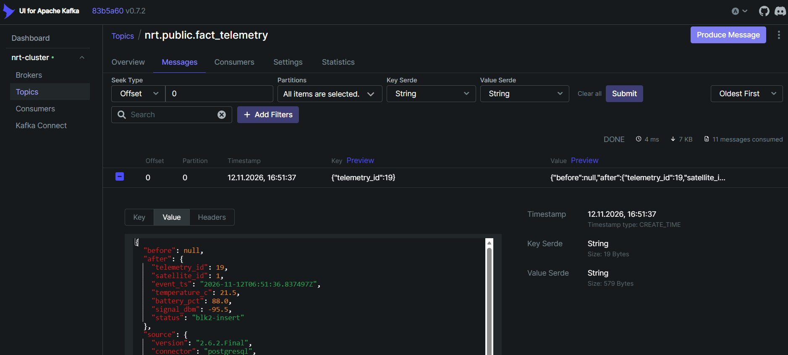

Сверка количества: в топике `nrt.public.fact_telemetry` ровно столько сообщений, сколько строк
изменено в БД (11).

## Задание 4. Обновление коннектора

В уже работающий коннектор (второй не создавался) добавлена таблица `public.dim_satellites`:
`table.include.list` расширен до `public.fact_telemetry,public.dim_satellites`. Коннектор
перезапустился сам, публикация `dbz_pub` расширена автоматически благодаря
`publication.autocreate.mode=filtered`.

После ручного `INSERT` и `UPDATE` в `dim_satellites` появился второй топик
`nrt.public.dim_satellites`, события содержат `before` и `after`:

```json
{"before":null,"after":{"satellite_id":...,"name":...,"orbit_type":"LEO","altitude_km":619.0,"status":"active"}, ...}
```

Топик `nrt.public.dim_satellites` и события в нём:

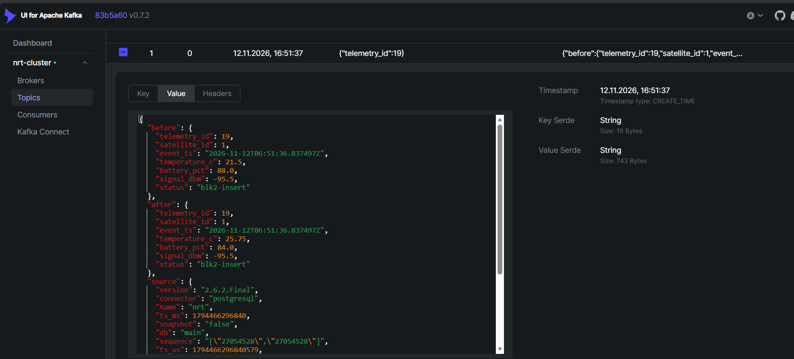

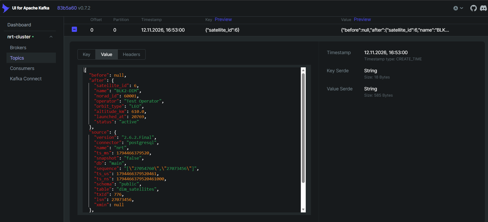

Проверка изоляции таблиц: `simulate_telemetry(10)` изменил только `fact_telemetry` — счётчик
топика `nrt.public.fact_telemetry` вырос, а `nrt.public.dim_satellites` остался неизменным.
События разных таблиц не смешиваются: один топик = одна таблица.

### Итог Блока 2

| Проверка | Результат |
|---|---|
| Коннектор и задача в статусе RUNNING | ✅ |
| Два топика, по одному на таблицу | ✅ `nrt.public.fact_telemetry`, `nrt.public.dim_satellites` |
| Слот создан автоматически и активен | ✅ `debezium_slot`, `active = t` |
| Обе таблицы в публикации | ✅ `dbz_pub` |
| `UPDATE` содержит `before` и `after` | ✅ |
| Числа приходят числами, не Base64 | ✅ `decimal.handling.mode=double` |

Статус коннектора в Kafka UI:

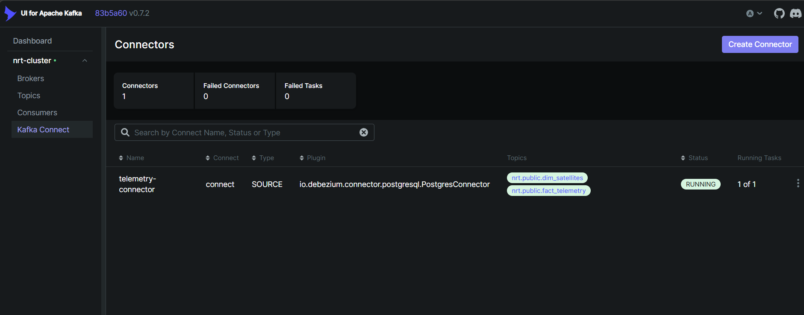

Оба топика и число сообщений:

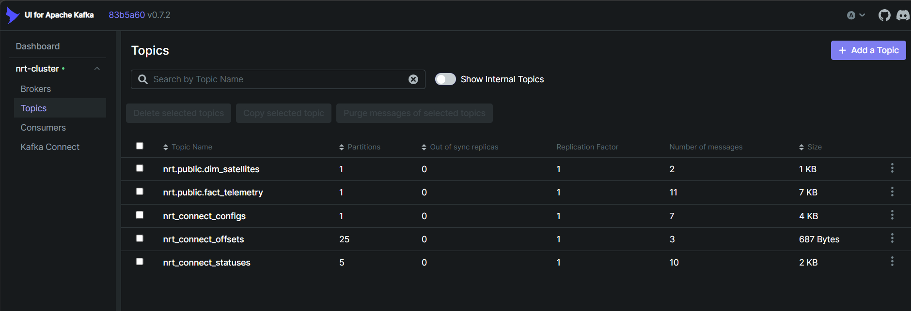

---

# Состав сдачи

```
Фамилия_ИО_практика_20261026.zip
├── cdc.sql                   запросы Блока 1 и Блока 2
├── connector.json            итоговый конфиг коннектора
├── docker-compose.yml        PostgreSQL + Kafka + Connect + Kafka UI
├── report.md                 этот отчёт
└── screenshots/              15 скриншотов
```
