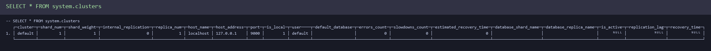
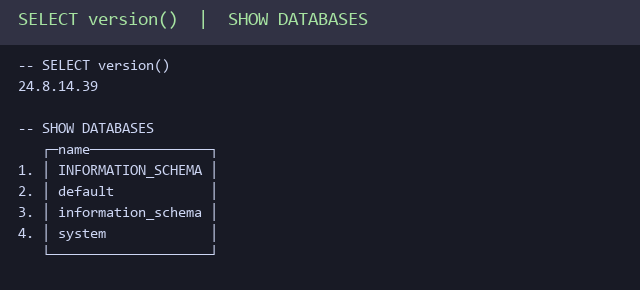
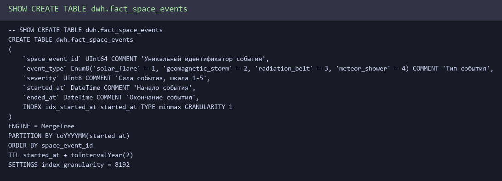
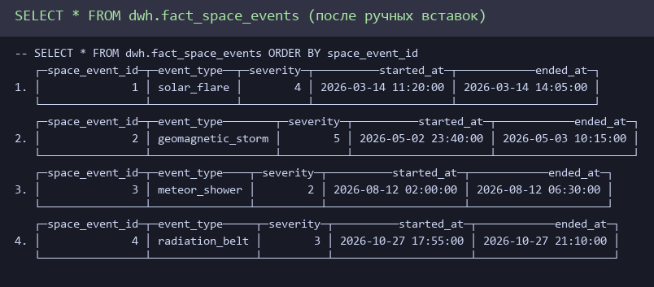
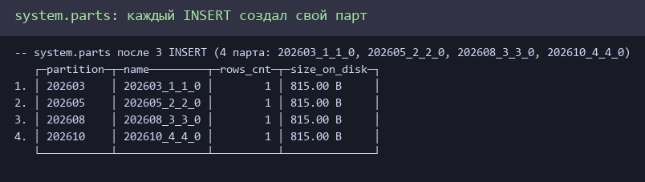
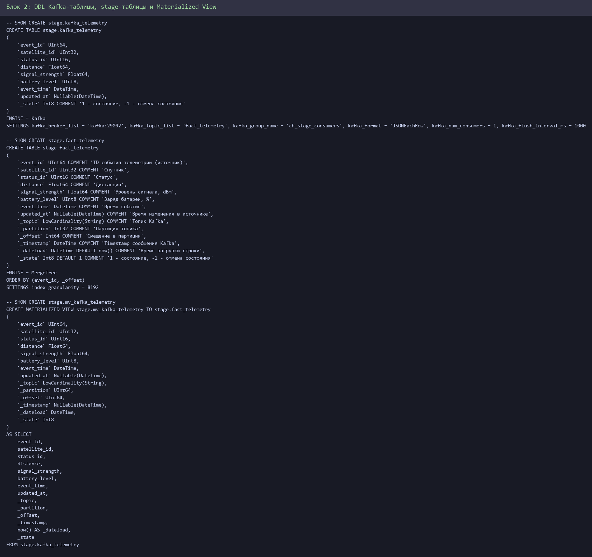
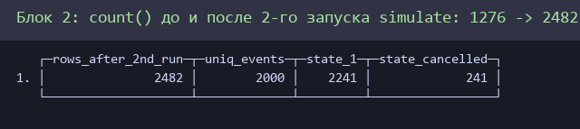
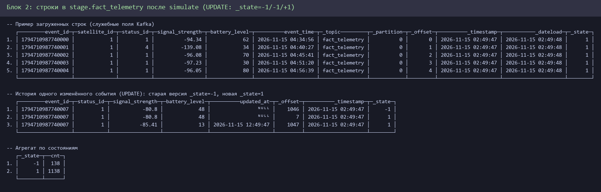

# Отчёт по практике «ClickHouse» (2026-11-16)

**Модель данных «События космической погоды» / телеметрия спутников**
Версия ClickHouse: **24.8.14.39**, single node, Docker. Kafka (cp-kafka 7.6.0, KRaft) — для Блока 2.

---

## Стенд (Задача 1)

`docker-compose.yaml` поднимает два контейнера в собственной сети:

| Сервис | Образ | Порты |
|---|---|---|
| `clickhouse` | clickhouse/clickhouse-server:24.8 | 8123 (HTTP, DBeaver/JDBC), 9000 (native) |
| `kafka` (kafka-block5) | confluentinc/cp-kafka:7.6.0 | 9092 (для продюсера с хоста) |

Подключение из DBeaver: драйвер ClickHouse (com.clickhouse), URL `jdbc:clickhouse://localhost:8123`,
пользователь `default`, без пароля.

Проверка конфигурации кластера и версии:

* 

Кластер `default`: 1 шард, 1 реплика, узел `localhost:9000` — конфигурация single node.

* 

`SELECT version()` → **24.8.14.39**.

SQL: [`sql/01_task1_env_check.sql`](sql/01_task1_env_check.sql), выводы: `results/01_clusters.txt`, `results/01_version.txt`.

---

## Блок 1

### Задача 2. Таблица `dwh.fact_space_events`

DDL ([`sql/02_task2_ddl.sql`](sql/02_task2_ddl.sql)):

```sql
CREATE TABLE dwh.fact_space_events
(
    space_event_id UInt64 COMMENT 'Уникальный идентификатор события',
    event_type     Enum8('solar_flare' = 1, 'geomagnetic_storm' = 2,
                         'radiation_belt' = 3, 'meteor_shower' = 4) COMMENT 'Тип события',
    severity       UInt8 COMMENT 'Сила события, шкала 1-5',
    started_at     DateTime COMMENT 'Начало события',
    ended_at       DateTime COMMENT 'Окончание события',
    INDEX idx_started_at started_at TYPE minmax GRANULARITY 1
)
ENGINE = MergeTree
PARTITION BY toYYYYMM(started_at)
ORDER BY (space_event_id)
TTL started_at + INTERVAL 2 YEAR DELETE
SETTINGS index_granularity = 8192;
```

**Обоснование выбора**

| Решение | Обоснование |
|---|---|
| `space_event_id UInt64` | По модели — положительное целое; UInt64 покрывает весь диапазон без знака, фиксированные 8 байт, монотонные значения хорошо сжимаются. |
| `event_type Enum8` | Строка ровно с 4 значениями: Enum8 хранит **1 байт** вместо строк, даёт встроенную валидацию (чужое значение не вставится) и отличный коэффициент сжатия, при этом выводится читаемой строкой. |
| `severity UInt8` | Шкала 1–5 — достаточно 1 байта. |
| `started_at`, `ended_at` `DateTime` | Дата+время с точностью до секунды — 4 байта; для событий космической погоды субсекундная точность не нужна (DateTime64 избыточен). |
| Движок `MergeTree` | Стандарт для DWH-таблиц в ClickHouse: columnar-хранение, первичный ключ, партиции, фоновые слияния, TTL, репликация. Log/TinyLog не держат первичный ключ и TTL, Buffer — не для хранения. |
| `PARTITION BY toYYYYMM(started_at)` | Поток событий размечен временем. Месячные партиции: (а) отсечение месяцев в запросах по времени, (б) дешёвое управление жизненным циклом (`DROP PARTITION`), (в) разумное число партиций ~12/год (рекомендация ClickHouse — сотни-тысячи, не десятки тысяч). |
| `ORDER BY (space_event_id)` | Точечный поиск/JOIN по уникальному идентификатору события; монотонный id даёт эффективный primary-key индекс. Альтернативы (ключ по времени/типу) исследованы в Задаче 4. Дополнительно добавлен **minmax-индекс по `started_at`** — он отсекает гранулы по времени, т.к. время не входит в первичный ключ. |
| `TTL started_at + INTERVAL 2 YEAR DELETE` | Ретеншн: события старше 2 лет автоматически удаляются; при `ttl_only_drop_parts=1` удаление сводится к дешёвому отбрасыванию целых партиций. |

**Проверка**

* `SHOW CREATE TABLE`: 
* Вставка 4 строк тремя INSERT-ами и SELECT: 
* `system.parts` — **каждый INSERT создал свой парт** (4 INSERT → 4 парта, имена вида `202603_1_1_0`, т.е. `партиция_блок_блок_уровень_слияний`):
  

### Задача 3. Генерация 5 млн строк за текущий год

Запрос ([`sql/03_task3_generate.sql`](sql/03_task3_generate.sql)) — данные генерируются средствами ClickHouse
(`numbers(5000000)` + `rand()`), вставка выполнилась за **~1.3 сек**:

```sql
INSERT INTO dwh.fact_space_events
SELECT
    number + 1 AS space_event_id,
    arrayElement(['solar_flare', 'geomagnetic_storm', 'radiation_belt', 'meteor_shower'],
                 1 + rand() % 4) AS event_type,
    1 + rand() % 5 AS severity,
    toDateTime('2026-01-01 00:00:00') + (rand() % 31536000) AS started_at,  -- случайная секунда 2026 года
    started_at + (60 + rand() % 10740) AS ended_at                          -- длительность 1 мин..3 ч
FROM numbers(5000000);
```

**Проверка** (скриншоты: [генерация](screenshots/06-task3-generate.png), [партиции](screenshots/07-task3-parts.png)):

| Проверка | Результат |
|---|---|
| Количество строк | **5 000 004** (5 млн сгенерированных + 4 ручных из Задачи 2) |
| Распределение по `event_type` | равномерное: solar_flare 25.01%, geomagnetic_storm 24.98%, radiation_belt 25.01%, meteor_shower 25.00% |
| Распределение по `severity` | равномерное: каждая оценка 19.98–20.03% |
| Число партиций | **12** (202601–202612, по одной на месяц) |
| Число партов (снимок) | 44 активных парта (шёл фоновый merge), после `OPTIMIZE FINAL` — 12 |
| Размер на диске | 64.49 MiB (~13.5 байт/строки) |
| Границы `started_at` | 2026-01-01 00:00:16 … 2026-12-31 23:59:58 — все события внутри текущего года |

Примечание: `ended_at` может заходить в начало 2027 максимум на 3 часа (длительность события до 3 ч) — это соответствует модели, партиционирование ведётся по `started_at`.

### Задача 4. Тестирование ключа партиционирования и ключа сортировки

**DDL вариантов** ([`sql/04_task4_variants_ddl.sql`](sql/04_task4_variants_ddl.sql)) — одинаковая структура, одинаковые данные (`INSERT ... SELECT` из `dwh.fact_space_events`, после загрузки `OPTIMIZE FINAL`):

| Вариант | `PARTITION BY` | `ORDER BY` | Партиций | Партов | Размер | Сжатие |
|---|---|---|---|---|---|---|
| A | — (нет) | `(space_event_id)` | 1 | 1 | 64.10 MiB | 1.34 |
| B | `toYYYYMM(started_at)` | `(started_at)` | 12 | 12 | 65.95 MiB | 1.30 |
| C | `toDate(started_at)` | `(event_type, severity, started_at)` | 365 | 365 | 60.37 MiB | 1.43 |
| D (итоговый, добавлен для обоснования выбора) | `toYYYYMM(started_at)` | `(event_type, severity, started_at)` | 12 | 12 | 60.19 MiB | 1.43 |

Наблюдение при загрузке: в вариант C (365 дневных партиций) не удалось вставить год одним INSERT —
сработал защитный лимит `max_partitions_per_insert_block = 100`; потребовалось поднять его
(`SETTINGS max_partitions_per_insert_block = 400`). Это первый практический минус избыточного партиционирования.

Скриншот: [system.parts по вариантам](screenshots/12-task4-parts-stats.png)

**Тестовые запросы** ([`sql/05_task4_queries.sql`](sql/05_task4_queries.sql)):

1. Q1 — события за месяц (май 2026): `WHERE started_at >= '2026-05-01' AND started_at < '2026-06-01'`
2. Q2 — события за день (15.05.2026)
3. Q3 — `WHERE event_type = 'geomagnetic_storm' AND severity >= 4`
4. Q4 — количество событий по `event_type` за год (`GROUP BY event_type`)

**Методика замера**: `EXPLAIN indexes = 1` (Parts: x/y, Granules: x/y) + `system.query_log`
(`query_duration_ms`, `read_rows`, `read_bytes`, по `query_id`); холодный прогон после
`SYSTEM DROP MARK CACHE` и минимальное время из 3 прогонов. Скрипты: [`scripts/bench_task4.sh`](scripts/bench_task4.sh),
[`scripts/timings3_task4.sh`](scripts/timings3_task4.sh). Полные выводы: `results/task4/variant_{A,B,C,D}.txt`.

**EXPLAIN indexes = 1** (парты и гранулы):

| Запрос | A (нет парт., key=id) | B (YYYYMM, key=time) | C (date, key=type,sev,time) | D (YYYYMM, key=type,sev,time) |
|---|---|---|---|---|
| Q1 месяц | Parts 1/1, Granules 611/611 | **0 гранул — «Optimized trivial count» из метаданных партов** | Parts 31/365, Granules 62/730 | Parts 1/12, Granules 52/616 (фактически trivial count) |
| Q2 день | Parts 1/1, Granules 611/611 | Parts 1/12, Granules **3/616** | Parts 1/365, Granules **2/730** | Parts 1/12, Granules 40/616 |
| Q3 тип+severity | Parts 1/1, Granules 611/611 | Parts 12/12, Granules 616/616 | Parts 365/365, Granules **365/730** | Parts 12/12, Granules **73/616** |
| Q4 group by type | Granules 611/611 | Granules 616/616 | Granules 730/730 | Granules 616/616 |

Скриншоты EXPLAIN: [A](screenshots/08-explain-A.png) · [B](screenshots/09-explain-B.png) · [C](screenshots/10-explain-C.png) · [D](screenshots/11-explain-D.png)

**Замеры из system.query_log** (min из 3 прогонов; скриншот [timings](screenshots/13-task4-timings.png)):

| Запрос | Метрика | A | B | C | D |
|---|---|---|---|---|---|
| Q1 месяц | ms / rows / bytes | 7 / 5 000 004 / 20.0 MB | **2 / 1 / 16 B** | 6 / 424 034 / 1.7 MB | 3 / 155 649 / 0.6 MB |
| Q2 день | ms / rows / bytes | 6 / 5 000 004 / 20.0 MB | **2 / 16 385 / 66 KB** | 3 / 13 684 / 55 KB | 3 / 327 680 / 1.3 MB |
| Q3 тип+severity | ms / rows / bytes | 8 / 5 000 004 / 10.0 MB | 10 / 5 000 004 / 10.0 MB | 47 / 2 990 080 / 6.0 MB | **5 / 196 609 / 0.4 MB** |
| Q4 group by type | ms / rows / bytes | **5** / 5 000 004 / 5.0 MB | 7 / 5 000 004 / 5.0 MB | 18 / 5 000 004 / 5.0 MB | 7 / 5 000 004 / 5.0 MB |

**Письменные выводы**

1. **Q1 (месяц)** — лучший **B**. Месячная партиция совпадает с интервалом запроса, а `started_at` — первый столбец ключа сортировки: ClickHouse ответил на `count()` прямо из метаданных партов (MinMax-индексы покрывают диапазон целиком — «Optimized trivial count»), прочитав 16 байт за 2 мс. C тоже отсекает 364 партиции, но внутри 31 дневного парта гранулы не отсекаются (`started_at` — третий столбец ключа) и читается весь месяц. A читает всё (20 MB).
2. **Q2 (день)** — лучшие **B и C** (2–3 мс, единицы-десятки тысяч строк). C чуть точнее (2 гранулы из 730) благодаря дневным партициям; B отсекает и партицию, и гранулы по ключу. D здесь хуже по объёму (327 тыс. строк): `started_at` стоит в ключе третьим и гранулы почти не отсекаются. A — худший (полный скан).
3. **Q3 (тип + severity)** — лучший **D**: читается 196 609 строк из 5 млн (12% гранул), 5 мс. Работает правило «равенство → диапазон»: `event_type = 'geomagnetic_storm'` (равенство, 1-й столбец) + `severity >= 4` (диапазон, 2-й столбец) отсекают всё, кроме 2 префиксов из 20. **B** не помогает ключу (`Condition: true` — полный скан 5 млн строк), **A** — тоже.
4. **Q4 (GROUP BY за год)** — всегда полный скан (фильтра нет), у всех ~5 мс. A чуть быстрее за счёт 1 парта; C медленнее всех (18 мс) — накладные расходы на открытие 365 партов. Сжатие у C/D лучше (1.43 против 1.30) — `event_type`/`severity` в ключе сортировки идут отсортированными сериями, но в данном запросе это не даёт выигрыша.
5. **Как порядок столбцов в `ORDER BY` повлиял на запрос 3.** В C/D ключ начинается с `event_type`, по которому в запросе равенство — первичный индекс сразу фиксирует префикс; следующий столбец `severity` уточняет диапазон `>= 4` внутри префикса → отсекается 87–94% гранул (в D — 73/616). Если бы `severity` стоял **первым**, диапазон `severity >= 4` на первом столбце отсекал бы только префиксы severity 1–3 (60% данных), а равенство по `event_type` на втором столбце уже не помогло бы отсекать гранулы внутри оставшихся префиксов — для запросов только по типу (без severity) такой ключ почти бесполезен. Третий столбец `started_at` на Q3 не влияет: пока первые столбцы не зафиксированы равенством, движок не может его использовать. Общий принцип: **столбцы с условием равенства — в начало ключа, столбцы с диапазонами — после них, остальные — по селективности**.
6. **Итоговый выбор ключей** — вариант **D: `PARTITION BY toYYYYMM(started_at)`, `ORDER BY (event_type, severity, started_at)`** (таблица `dwh.fact_space_events_d`):
   * лучший на самом дорогом фильтрующем запросе Q3 (в 2 раза быстрее полного скана, в 25 раз меньше чтение);
   * сопоставим с лучшими на Q1/Q2 (2–3 мс — партиция отсекает месяц);
   * лучшее сжатие (1.43) — сортированные серии Enum8/UInt8;
   * всего 12 партиций на год — нет проблем вставки (`max_partitions_per_insert_block`) и накладных расходов сотен мелких партов, дешёвый TTL/DROP PARTITION.
   * Запасной вариант под чисто «временную» нагрузку — B (`ORDER BY started_at`): он мгновенно отвечает на диапазоны по времени, но бесполезен для фильтров по типу/силе события. Вариант C показывает, что дневное партиционирование при 5 млн строк/год — антипаттерн: 365 партов по ~14 тыс. строк лишают primary-ключ гранулярности (гранула 8192 строк больше префикса типа внутри парта) и добавляют накладные расходы, из-за которых Q3 у C оказался **медленнее** полного скана A.

---

## Блок 2. Реализация kafka-consumer

**Схема pipeline** (`sql/06_block2_kafka_pipeline.sql`):

```
scripts/simulate.py (Python, kafka-python)
        │  JSONEachRow, topic fact_telemetry
        ▼
stage.kafka_telemetry  (ENGINE = Kafka)
        │  Materialized View stage.mv_kafka_telemetry
        ▼
stage.fact_telemetry   (MergeTree, append-only)
```

**1. Kafka-таблица** — читает топик `fact_telemetry` (JSONEachRow) консюмер-группой `ch_stage_consumers`:

```sql
CREATE TABLE stage.kafka_telemetry
(
    event_id UInt64, satellite_id UInt32, status_id UInt16,
    distance Float64, signal_strength Float64, battery_level UInt8,
    event_time DateTime, updated_at Nullable(DateTime),
    _state Int8 COMMENT '1 - состояние, -1 - отмена состояния'
)
ENGINE = Kafka
SETTINGS kafka_broker_list = 'kafka:29092',
         kafka_topic_list = 'fact_telemetry',
         kafka_group_name = 'ch_stage_consumers',
         kafka_format = 'JSONEachRow',
         kafka_num_consumers = 1,
         kafka_flush_interval_ms = 1000;
```

**2. Stage-таблица** (MergeTree) — повторяет структуру `fact_telemetry` из практики block3
(`event_id, satellite_id, status_id, distance, signal_strength, battery_level, event_time, updated_at`)
и добавляет служебные поля:

```sql
CREATE TABLE stage.fact_telemetry
(
    event_id        UInt64,
    satellite_id    UInt32,
    status_id       UInt16,
    distance        Float64,
    signal_strength Float64,
    battery_level   UInt8,
    event_time      DateTime,
    updated_at      Nullable(DateTime),
    -- виртуальные столбцы Kafka
    _topic     LowCardinality(String),
    _partition Int32,
    _offset    Int64,
    _timestamp DateTime,
    -- служебные поля загрузки
    _dateload  DateTime DEFAULT now(),
    _state     Int8      DEFAULT 1     -- 1 - состояние, -1 - отмена состояния
)
ENGINE = MergeTree
ORDER BY (event_id, _offset);
```

Партиционирование у stage-таблицы сознательно отсутствует: данные короткоживущие и небольшие,
ключ сортировки `(event_id, _offset)` поддерживает дедупликацию по событию в порядке поступления.

**3. Materialized View** — перекладывает сообщения в stage, подставляя время загрузки:

```sql
CREATE MATERIALIZED VIEW stage.mv_kafka_telemetry TO stage.fact_telemetry AS
SELECT event_id, satellite_id, status_id, distance, signal_strength, battery_level,
       event_time, updated_at, _topic, _partition, _offset, _timestamp,
       now() AS _dateload, _state
FROM stage.kafka_telemetry;
```

Полный DDL всех объектов: 

**4. Проверка** (скрипт [`scripts/simulate.py`](scripts/simulate.py) — адаптация `simulate` из практики block3:
та же логика статусов/сигнала/батареи; INSERT публикует строку с `_state=1`, UPDATE — **две** строки:
отмена старого состояния `_state=-1` и новое состояние `_state=1`; stage — append-only, история хранится строками):

| Момент | `SELECT count() FROM stage.fact_telemetry` |
|---|---|
| До запуска скрипта | **0** |
| После 1-го запуска (1000 вставок + 138 UPDATE) | **1276** = 1000 + 138×2 |
| После 2-го запуска (1000 вставок + 103 UPDATE) | **2482** (1276 + 1206) |

Скриншот «до/после»: 

Новые строки появляются автоматически за ~1–2 секунды (kafka_flush_interval_ms = 1000), в т.ч. строки, изменённые UPDATE:

* Пример строк со служебными полями и история изменённого события
  `event_id=1794710987740007` (оригинал `_state=1`, offset 7 → отмена старой версии `_state=-1`, offset 1046 → новая версия `_state=1`, offset 1047, заполнен `updated_at`):
  

Агрегат после двух запусков: `_state=1` → 2241 строка, `_state=-1` → 241 отмена, 2000 уникальных событий.
Актуальное состояние каждого события далее на следующем слое (dwh) получают, например, так:
`GROUP BY event_id` + `argMax(..., _offset)` (последняя по потоку версия) либо `WHERE _state = 1` с дедупликацией —
в рамках Блока 2 это уже этап трансформации в DWH.

---

## Состав проекта

```
block5/
├── docker-compose.yaml          # ClickHouse single node + Kafka
├── report.md                    # этот отчёт
├── README.md                    # как поднять и повторить
├── sql/
│   ├── 01_task1_env_check.sql   # system.clusters, version()
│   ├── 02_task2_ddl.sql         # DWH + fact_space_events + проверки
│   ├── 03_task3_generate.sql    # генерация 5 млн строк + проверки
│   ├── 04_task4_variants_ddl.sql# варианты A/B/C (+D) и загрузка
│   ├── 05_task4_queries.sql     # тестовые запросы и методика замера
│   └── 06_block2_kafka_pipeline.sql # Kafka-таблица + stage + MV
├── scripts/
│   ├── simulate.py              # продюсер (вставки и UPDATE) в Kafka
│   ├── bench_task4.sh           # EXPLAIN + query_log по вариантам
│   ├── timings3_task4.sh        # 3 прогона, min время
│   └── render_screenshots.py    # рендер результатов в PNG
├── screenshots/                 # скриншоты результатов (01–16)
└── results/                     # текстовые выводы всех запросов
```
